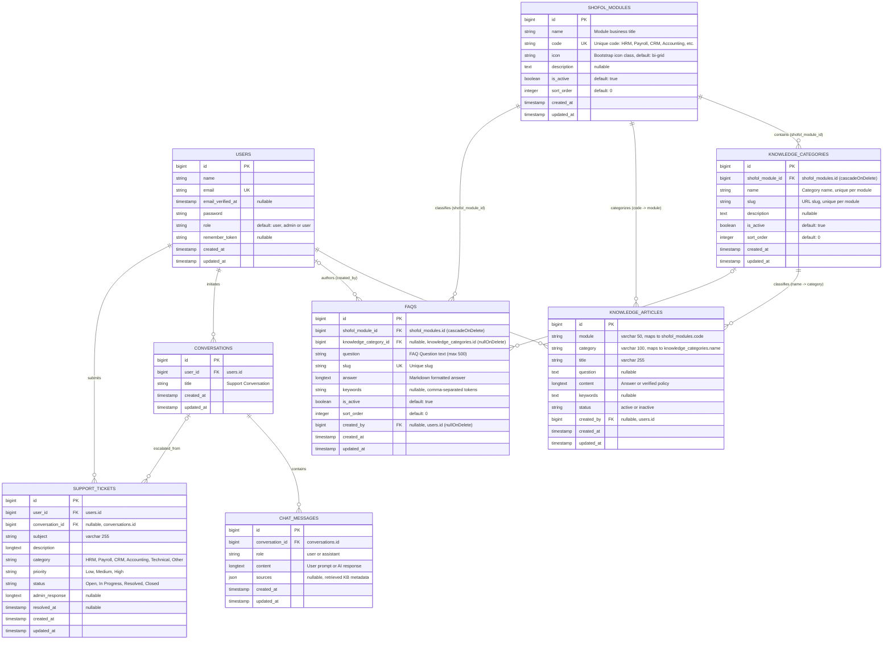
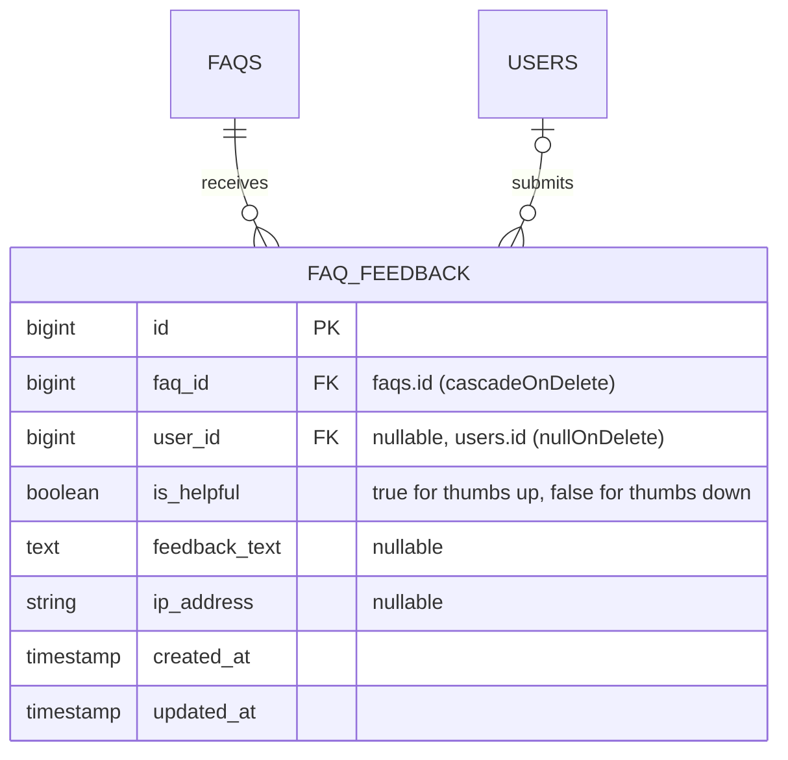

# Shofol Connect — Entity-Relationship Documentation (EPIC 01)
**Document Version:** 1.3.0  
**Phase:** Phase 4 (Dedicated FAQ Management — SC-AI-13)  
**Target Environment:** Laravel 12 / PHP 8.2+ / MySQL 8.0+  
**Status:** Approved Architecture Baseline  

---

## 1. Overview & Context

This document details the Entity-Relationship Data Model for **Shofol Connect (EPIC 01: Foundation & Knowledge Base)**. It reflects the **actual, active database schema** defined in the Laravel migrations and Eloquent models within `C:\ShofolConnect`, including the **Phase 2 implementation of SC-AI-11 (Dynamic Shofol Module Management)**, the **Phase 3 implementation of SC-AI-12 (Dynamic Knowledge Category Management)**, and the **Phase 4 implementation of SC-AI-13 (Dedicated FAQ Management)**.

### Architectural Design Principles
1. **Single Source of Truth for Roles:** User access control (`admin`, `user`) is persisted directly on `users.role` without external role-permission table overhead.
2. **Dynamic Shofol Module Registry (SC-AI-11):** The `shofol_modules` table provides a dynamic catalog for enterprise business modules (`name`, `code`, `icon`, `description`, `is_active`, `sort_order`).
3. **Module-Scoped Dynamic Category Hierarchy (SC-AI-12):** The `knowledge_categories` table introduces relational topic categories strictly scoped to their parent `shofol_modules.id`, with per-module uniqueness enforced on both `name` and `slug`.
4. **Dedicated FAQ Data Model (SC-AI-13):** The `faqs` table provides a dedicated repository for administrative FAQs linked directly to `shofol_modules` (`shofol_module_id`) and optionally categorized under `knowledge_categories` (`knowledge_category_id`), with unique slugs, keyword tagging, and unified RAG retrieval integration.
5. **Safe Backward-Compatible Mapping Strategy:**
   - Existing `knowledge_articles.module` and `knowledge_articles.category` column values remain 100% intact without column drops, renames, or data loss.
   - The relationship between `shofol_modules` and `knowledge_articles` is mapped via `shofol_modules.code = knowledge_articles.module`.
   - The relationship between `knowledge_categories` and `knowledge_articles` is mapped via `knowledge_categories.name = knowledge_articles.category`.
   - Eloquent models provide native relationships: `KnowledgeCategory::hasMany(KnowledgeArticle::class, 'category', 'name')` and `KnowledgeArticle::belongsTo(KnowledgeCategory::class, 'category', 'name')`.
   - Updating a module's `code` or a category's `name` automatically cascades to all referenced articles.
   - Deleting a module or category while articles or FAQs reference it is strictly guarded at the application level with descriptive feedback.
6. **Conversational AI & Auditability:** Conversations and chat messages maintain a 1:N hierarchy with parent-child cascading deletion and JSON storage for retrieved knowledge sources (articles and FAQs).
7. **Seamless Support Escalation:** Support tickets link optionally to the originating AI chat conversation (`nullOnDelete`), preserving context without coupling ticket lifespan to conversation history.

---

## 2. Mermaid Entity-Relationship Diagram (Active Schema)

The diagram below reflects the **8 core business tables** currently migrated and operating in Shofol Connect:

---

## 3. Data Dictionary (Active Database Tables)

### 3.1. Table: `faqs` (Implemented in Phase 4 — SC-AI-13)
Stores administrative frequently asked questions categorized by module and optional category, integrated into unified RAG retrieval.

| Column Name | Data Type | Nullable | Key / Index | Default | Description |
| :--- | :--- | :---: | :---: | :---: | :--- |
| `id` | `BIGINT UNSIGNED` | No | **PK**, Auto Inc | *None* | Primary identifier for the FAQ. |
| `shofol_module_id` | `BIGINT UNSIGNED` | No | **FK, INDEX** | *None* | Parent module reference to `shofol_modules.id` (`cascadeOnDelete`). |
| `knowledge_category_id` | `BIGINT UNSIGNED` | Yes | **FK, INDEX** | `NULL` | Optional category reference to `knowledge_categories.id` (`nullOnDelete`). |
| `question` | `VARCHAR(500)` | No | | *None* | Frequently asked question text. |
| `slug` | `VARCHAR(255)` | No | **UNIQUE, INDEX** | *None* | Unique URL-safe slug for routing and reference. |
| `answer` | `LONGTEXT` | No | | *None* | Safe, readable FAQ response content. |
| `keywords` | `VARCHAR(500)` | Yes | | `NULL` | Comma-separated search tokens for discovery and RAG retrieval. |
| `is_active` | `TINYINT(1)` | No | **INDEX** | `1` (true) | Lifecycle state; inactive FAQs are excluded from normal RAG retrieval. |
| `sort_order` | `INT` | No | **INDEX** | `0` | Display sorting priority within module/category. |
| `created_by` | `BIGINT UNSIGNED` | Yes | **FK** | `NULL` | Creator reference to `users.id` (`nullOnDelete`). |
| `created_at` | `TIMESTAMP` | Yes | | `NULL` | FAQ creation timestamp. |
| `updated_at` | `TIMESTAMP` | Yes | | `NULL` | FAQ modification timestamp. |

* **Indexes:**
  - Unique index on `slug`
  - Index on `shofol_module_id`
  - Index on `knowledge_category_id`
  - Index on `is_active`
  - Index on `sort_order`
  - Composite index on `['shofol_module_id', 'is_active']`
  - Composite index on `['shofol_module_id', 'knowledge_category_id']`
* **Model:** [`App\Models\Faq`](file:///c:/ShofolConnect/app/Models/Faq.php)  
* **Migration:** `2026_10_12_120000_create_faqs_table.php`

---

### 3.2. Table: `knowledge_categories` (Implemented in Phase 3 — SC-AI-12)
Stores module-scoped functional categories for organizing knowledge articles.

| Column Name | Data Type | Nullable | Key / Index | Default | Description |
| :--- | :--- | :---: | :---: | :---: | :--- |
| `id` | `BIGINT UNSIGNED` | No | **PK**, Auto Inc | *None* | Primary identifier for the category. |
| `shofol_module_id` | `BIGINT UNSIGNED` | No | **FK, INDEX** | *None* | Parent module reference to `shofol_modules.id` (`cascadeOnDelete`). |
| `name` | `VARCHAR(255)` | No | **UNIQUE (Composite)** | *None* | Human-readable category title, unique per module. |
| `slug` | `VARCHAR(255)` | No | **UNIQUE (Composite)** | *None* | URL-safe slug, unique per module. |
| `description` | `TEXT` | Yes | | `NULL` | Topic scope guidelines for article placement. |
| `is_active` | `TINYINT(1)` | No | **INDEX** | `1` (true) | Lifecycle state; inactive categories are hidden from new articles. |
| `sort_order` | `INT` | No | **INDEX** | `0` | Display sorting priority within the parent module. |
| `created_at` | `TIMESTAMP` | Yes | | `NULL` | Category creation timestamp. |
| `updated_at` | `TIMESTAMP` | Yes | | `NULL` | Category modification timestamp. |

* **Indexes:**
  - Unique composite on `['shofol_module_id', 'name']`
  - Unique composite on `['shofol_module_id', 'slug']`
  - Index on `is_active`
  - Index on `sort_order`
  - Composite index on `['shofol_module_id', 'is_active']`
  - Composite index on `['shofol_module_id', 'sort_order']`
* **Model:** [`App\Models\KnowledgeCategory`](file:///c:/ShofolConnect/app/Models/KnowledgeCategory.php)  
* **Migration:** `2026_10_12_110000_create_knowledge_categories_table.php`

---

### 3.3. Table: `shofol_modules` (Implemented in Phase 2 — SC-AI-11)
Maintains the dynamic catalog of Shofol business departments and products.

| Column Name | Data Type | Nullable | Key / Index | Default | Description |
| :--- | :--- | :---: | :---: | :---: | :--- |
| `id` | `BIGINT UNSIGNED` | No | **PK**, Auto Inc | *None* | Primary identifier for the module. |
| `name` | `VARCHAR(255)` | No | | *None* | Full business title of module (e.g., Human Resource Management). |
| `code` | `VARCHAR(50)` | No | **UNIQUE, INDEX** | *None* | Unique alphanumeric code/slug (e.g., `HRM`, `Payroll`, `CRM`, `Accounting`). |
| `icon` | `VARCHAR(100)` | Yes | | `'bi-grid'` | Bootstrap icon class identifier. |
| `description` | `TEXT` | Yes | | `NULL` | Brief summary of department workflows and guidelines covered. |
| `is_active` | `TINYINT(1)` | No | **INDEX** | `1` (true) | Lifecycle flag; inactive modules are hidden from new article forms. |
| `sort_order` | `INT` | No | **INDEX** | `0` | Numerical sorting weight for display priority in lists and menus. |
| `created_at` | `TIMESTAMP` | Yes | | `NULL` | Record creation timestamp. |
| `updated_at` | `TIMESTAMP` | Yes | | `NULL` | Record modification timestamp. |

* **Indexes:**
  - Unique index on `code`
  - Index on `is_active`
  - Index on `sort_order`
  - Composite index on `['is_active', 'sort_order']`
* **Model:** [`App\Models\ShofolModule`](file:///c:/ShofolConnect/app/Models/ShofolModule.php)  
* **Migration:** `2026_10_12_100000_create_shofol_modules_table.php`

---

### 3.4. Table: `users`
Stores user identity, authentication credentials, and system role (`admin` or `user`).

| Column Name | Data Type | Nullable | Key / Index | Default | Description |
| :--- | :--- | :---: | :---: | :---: | :--- |
| `id` | `BIGINT UNSIGNED` | No | **PK**, Auto Inc | *None* | Primary identifier for the user. |
| `name` | `VARCHAR(255)` | No | | *None* | Full legal name of user or employee. |
| `email` | `VARCHAR(255)` | No | **UNIQUE** | *None* | User email address used for login and notifications. |
| `email_verified_at` | `TIMESTAMP` | Yes | | `NULL` | Timestamp when user confirmed their email address. |
| `password` | `VARCHAR(255)` | No | | *None* | Bcrypt-hashed user authentication password. |
| `role` | `VARCHAR(255)` | No | | `'user'` | Role-based permission tier: `'admin'` or `'user'`. |
| `remember_token` | `VARCHAR(100)` | Yes | | `NULL` | Token for "Remember Me" session persistence. |
| `created_at` | `TIMESTAMP` | Yes | | `NULL` | Record creation timestamp. |
| `updated_at` | `TIMESTAMP` | Yes | | `NULL` | Record last modification timestamp. |

* **Model:** [`App\Models\User`](file:///c:/ShofolConnect/app/Models/User.php)  
* **Migration:** `0001_01_01_000000_create_users_table.php`, `2026_10_07_100304_add_role_to_users_table.php`

---

### 3.5. Table: `knowledge_articles`
Stores official Shofol enterprise policies, SOPs, workflows, and FAQs for admin management and RAG query retrieval.

| Column Name | Data Type | Nullable | Key / Index | Default | Description |
| :--- | :--- | :---: | :---: | :---: | :--- |
| `id` | `BIGINT UNSIGNED` | No | **PK**, Auto Inc | *None* | Primary identifier for the article. |
| `module` | `VARCHAR(50)` | No | **INDEX** | *None* | Module key referencing `shofol_modules.code`. |
| `category` | `VARCHAR(100)` | No | | *None* | Category title referencing `knowledge_categories.name`. |
| `title` | `VARCHAR(255)` | No | | *None* | Human-readable title of policy or article. |
| `question` | `TEXT` | Yes | | `NULL` | Typical user question or intent phrasing. |
| `content` | `LONGTEXT` | No | | *None* | Complete authoritative answer, policy guidelines, or SOP text. |
| `keywords` | `TEXT` | Yes | | `NULL` | Comma-delimited keywords used for lexical ranking & RAG search. |
| `status` | `VARCHAR(20)` | No | **INDEX** | `'active'` | Publication lifecycle state: `'active'` or `'inactive'`. |
| `created_by` | `BIGINT UNSIGNED` | Yes | **FK** | `NULL` | Reference to `users.id` who authored the article (`nullOnDelete`). |
| `created_at` | `TIMESTAMP` | Yes | | `NULL` | Article creation timestamp. |
| `updated_at` | `TIMESTAMP` | Yes | | `NULL` | Article modification timestamp. |

* **Indexes:**
  - Single index on `module`
  - Single index on `status`
  - Composite index on `['module', 'status']`
* **Model:** [`App\Models\KnowledgeArticle`](file:///c:/ShofolConnect/app/Models/KnowledgeArticle.php)  
* **Migration:** `2026_10_11_175000_create_knowledge_articles_table.php`

---

### 3.6. Table: `conversations`
Tracks top-level chat sessions between users and the AI Assistant.

| Column Name | Data Type | Nullable | Key / Index | Default | Description |
| :--- | :--- | :---: | :---: | :---: | :--- |
| `id` | `BIGINT UNSIGNED` | No | **PK**, Auto Inc | *None* | Primary identifier of the conversation. |
| `user_id` | `BIGINT UNSIGNED` | No | **FK, INDEX** | *None* | Reference to `users.id` who owns this conversation (`cascadeOnDelete`). |
| `title` | `VARCHAR(255)` | No | | `'Support Conversation'` | Conversation header or topic summary. |
| `created_at` | `TIMESTAMP` | Yes | | `NULL` | Session start timestamp. |
| `updated_at` | `TIMESTAMP` | Yes | | `NULL` | Last activity timestamp. |

* **Indexes:**
  - Single index on `user_id`
* **Model:** [`App\Models\Conversation`](file:///c:/ShofolConnect/app/Models/Conversation.php)  
* **Migration:** `2026_10_11_180000_create_conversations_and_chat_messages_tables.php`

---

### 3.7. Table: `chat_messages`
Stores individual chronological messages in a chat conversation, including user prompts, AI responses, and RAG source citations.

| Column Name | Data Type | Nullable | Key / Index | Default | Description |
| :--- | :--- | :---: | :---: | :---: | :--- |
| `id` | `BIGINT UNSIGNED` | No | **PK**, Auto Inc | *None* | Primary identifier of the chat message. |
| `conversation_id` | `BIGINT UNSIGNED` | No | **FK** | *None* | Reference to `conversations.id` (`cascadeOnDelete`). |
| `role` | `VARCHAR(20)` | No | | *None* | Message sender role: `'user'` or `'assistant'`. |
| `content` | `LONGTEXT` | No | | *None* | Raw message text, markdown output, or policy fallback guidance. |
| `sources` | `JSON` | Yes | | `NULL` | JSON array of retrieved knowledge articles citing `id`, `title`, `module`. |
| `created_at` | `TIMESTAMP` | Yes | **INDEX** | `NULL` | Message submission timestamp. |
| `updated_at` | `TIMESTAMP` | Yes | | `NULL` | Message timestamp. |

* **Indexes:**
  - Composite index on `['conversation_id', 'created_at']`
* **Model:** [`App\Models\ChatMessage`](file:///c:/ShofolConnect/app/Models/ChatMessage.php)  
* **Migration:** `2026_10_11_180000_create_conversations_and_chat_messages_tables.php`

---

### 3.8. Table: `support_tickets`
Enables manual ticket filing and automated conversation escalation when user inquiries require human agent intervention.

| Column Name | Data Type | Nullable | Key / Index | Default | Description |
| :--- | :--- | :---: | :---: | :---: | :--- |
| `id` | `BIGINT UNSIGNED` | No | **PK**, Auto Inc | *None* | Primary ticket identifier. |
| `user_id` | `BIGINT UNSIGNED` | No | **FK, INDEX** | *None* | Reference to `users.id` who opened the ticket (`cascadeOnDelete`). |
| `conversation_id` | `BIGINT UNSIGNED` | Yes | **FK** | `NULL` | Reference to `conversations.id` if escalated (`nullOnDelete`). |
| `subject` | `VARCHAR(255)` | No | | *None* | Ticket issue summary. |
| `description` | `LONGTEXT` | No | | *None* | Detailed description of the issue or error. |
| `category` | `VARCHAR(50)` | No | **INDEX** | *None* | Functional module: `HRM`, `Payroll`, `CRM`, `Accounting`, `Technical`, `Other`. |
| `priority` | `VARCHAR(20)` | No | **INDEX** | `'Medium'` | Ticket urgency: `'Low'`, `'Medium'`, `'High'`. |
| `status` | `VARCHAR(20)` | No | **INDEX** | `'Open'` | Lifecycle state: `'Open'`, `'In Progress'`, `'Resolved'`, `'Closed'`. |
| `admin_response` | `LONGTEXT` | Yes | | `NULL` | Support representative resolution notes or official response. |
| `resolved_at` | `TIMESTAMP` | Yes | | `NULL` | Timestamp when ticket status was changed to Resolved or Closed. |
| `created_at` | `TIMESTAMP` | Yes | | `NULL` | Ticket creation timestamp. |
| `updated_at` | `TIMESTAMP` | Yes | | `NULL` | Ticket last update timestamp. |

* **Indexes:**
  - Single index on `user_id`
  - Single index on `status`
  - Single index on `category`
  - Single index on `priority`
  - Composite index on `['status', 'priority']`
* **Model:** [`App\Models\SupportTicket`](file:///c:/ShofolConnect/app/Models/SupportTicket.php)  
* **Migration:** `2026_10_11_181500_create_support_tickets_table.php`

---

## 4. Entity Relationships & Cardinality Matrix

| Parent Entity | Relationship | Child Entity | Key Mapping / Constraint | On Delete Action | Business Semantics |
| :--- | :---: | :--- | :--- | :--- | :--- |
| `shofol_modules` | **1 : N** | `knowledge_categories` | `shofol_modules.id = knowledge_categories.shofol_module_id` | `CASCADE` | A module has zero, one, or many categories. When an unreferenced module is deleted, its categories are purged. |
| `shofol_modules` | **1 : N** | `faqs` | `shofol_modules.id = faqs.shofol_module_id` | **PROTECTED** (Controller Blocked) | A module classifies zero, one, or many FAQs. Deleting a module referenced by FAQs is blocked at the controller level. |
| `knowledge_categories` | **0..1 : N** | `faqs` | `knowledge_categories.id = faqs.knowledge_category_id` | `SET NULL` | An FAQ optionally belongs to a category. Deleting a category nullifies `knowledge_category_id` on child FAQs without deleting the FAQ. |
| `knowledge_categories` | **1 : N** | `knowledge_articles` | `knowledge_categories.name = knowledge_articles.category` | **PROTECTED** (Controller Blocked) | A category classifies zero, one, or many articles. Deleting a category referenced by articles is blocked. Renaming cascades to articles. |
| `shofol_modules` | **1 : N** | `knowledge_articles` | `shofol_modules.code = knowledge_articles.module` | **PROTECTED** (Controller Blocked) | A module classifies zero, one, or many articles. Deleting a module referenced by articles is blocked. Renaming cascades to articles. |
| `users` | **1 : N** | `faqs` | `users.id = faqs.created_by` | `SET NULL` | A user (admin) can author FAQs. Deleting the author preserves the FAQ with `created_by = NULL`. |
| `users` | **1 : N** | `knowledge_articles` | `users.id = knowledge_articles.created_by` | `SET NULL` | A user (admin) can author articles. Deleting the author preserves the article with `created_by = NULL`. |
| `users` | **1 : N** | `conversations` | `users.id = conversations.user_id` | `CASCADE` | Deleting a user removes all their chat conversations. |
| `conversations` | **1 : N** | `chat_messages` | `conversations.id = chat_messages.conversation_id` | `CASCADE` | Deleting a conversation removes all contained messages. |
| `users` | **1 : N** | `support_tickets` | `users.id = support_tickets.user_id` | `CASCADE` | Deleting a user removes their submitted tickets. |
| `conversations` | **0..1 : N** | `support_tickets` | `conversations.id = support_tickets.conversation_id` | `SET NULL` | Escalated tickets preserve support history with `conversation_id = NULL` if the chat conversation is deleted. |

---

## 5. Infrastructure & Framework Tables

| Table Name | Purpose | Primary Key | Key Columns / Indexes |
| :--- | :--- | :--- | :--- |
| `sessions` | HTTP user session management. | `id` (VARCHAR) | `user_id` (Index), `last_activity` (Index), `payload`, `ip_address` |
| `password_reset_tokens` | Secure password reset verification. | `email` (VARCHAR) | `token`, `created_at` |
| `cache` / `cache_locks` | Application caching and atomic locks. | `key` (VARCHAR) | `value`, `expiration` |
| `jobs` / `failed_jobs` / `job_batches` | Asynchronous queue execution & failure logs. | `id` (BIGINT) | `queue`, `payload`, `attempts`, `reserved_at`, `failed_at` |

---

## 6. Future Scope: Planned Schema (EPIC 02 — Interactive Public FAQ Portal)

> [!NOTE]  
> Dedicated Administrative FAQ Management (**SC-AI-13**) is now **FULLY IMPLEMENTED** and active in the production schema (see Section 3.1). The schema below represents planned public-facing extensions for EPIC 02 (e.g., interactive public FAQ portal with user helpfulness voting and feedback tracking).

---

## 7. Schema Integrity & Validation Summary

| Requirement | Implementation Verification | Status |
| :--- | :--- | :---: |
| Primary Keys | Auto-incrementing unsigned 64-bit integers (`id`) across all tables. | Verified |
| Foreign Key & Mapping Constraints | Relational constraints between `knowledge_categories` and `shofol_modules` (`cascadeOnDelete`), `faqs` and `shofol_modules` (`cascadeOnDelete`), `faqs` and `knowledge_categories` (`nullOnDelete`), and safe mapping between `knowledge_categories.name` and `knowledge_articles.category` with protected deletion guards. | Verified |
| Indexing Strategy | Indexes on `shofol_module_id`, `knowledge_category_id`, `slug`, `name`, `is_active`, `sort_order`, composite `['shofol_module_id', 'is_active']`, and composite unique constraints on `['shofol_module_id', 'name']`. | Verified |
| Backward Compatibility | Zero column drops or renames; existing article categories preserved; legacy category edits supported without validation errors. | Verified |
| Dedicated FAQ Management (SC-AI-13) | `faqs` table migrated, Eloquent model with scopes and accessors, admin CRUD, safe deletion guards, and unified RAG retrieval integration. | Verified |
| Future Scope Segregation | Dedicated FAQ Management (**SC-AI-13**) fully implemented in Phase 4; EPIC 02 public feedback portal designated for future scope. | Verified |
